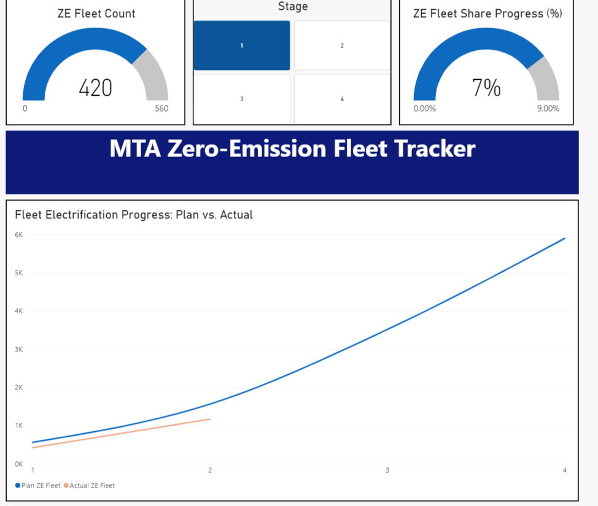

# Zero-Emission Transition Dashboard

An independent Power BI dashboard for exploring fleet electrification, depot phasing, and system-wide transition milestones.

## Preview

Use the preview images below to review the dashboard before downloading the packaged report.

## Download the dashboard

Download [`Tracker.pbix`](Tracker.pbix) to open the packaged Power BI report in Power BI Desktop.

## Included files

- `Tracker.pbix` — packaged Power BI dashboard
- `Data/` — supporting CSV data extracts used by the report
- `extract_all_tables.py` — utility script for extracting tables from source material
- `Zero-Emission Transition Plan.pdf` — reference document used during analysis
- `screenshots/` — dashboard preview images to review the report before downloading it

## Notes

This is an independent analytical project built from publicly available and project-provided data. It is not an official publication, product, or endorsement of any transit agency.

The report is provided for exploration and demonstration.

## License

The original code, documentation, and project materials are released under the [MIT License](LICENSE).

Source data and reference materials may be subject to separate terms from their original publishers.
